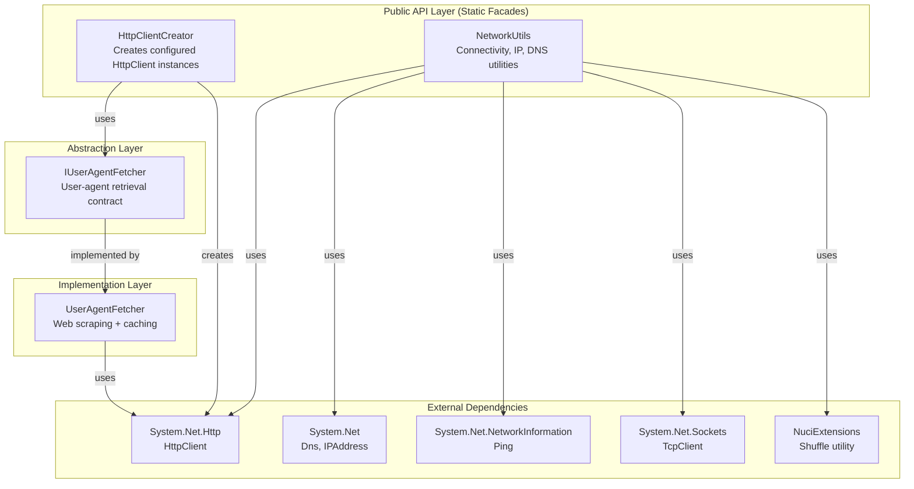
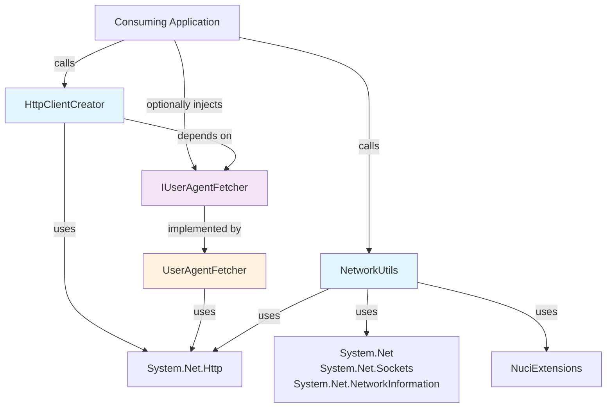

# Architecture

**Last Reviewed:** 2026-10-13  
**Complements:** [ARCHITECTURE.md](../ARCHITECTURE.md)

## Repository Purpose

NuciWeb.HTTP is a utility library for .NET 10 applications that simplifies common HTTP and network operations. It provides abstractions and helper methods for:

- Creating `HttpClient` instances with realistic User-Agent headers
- Detecting internet connectivity using multiple probing strategies
- Retrieving public IP addresses through fallback providers
- Performing reverse DNS lookups to resolve hostnames

The library is consumed as a NuGet package (`NuciWeb.HTTP`) and targets .NET 10.0.

## Architectural Decomposition

The library follows a **utility library** architectural style with three layers:

## Principal Capabilities

| Capability | Entry Point | Implementation | External Integration |
|------------|-------------|----------------|----------------------|
| HttpClient creation | `HttpClientCreator.CreateAsync()` | `UserAgentFetcher` | whatismybrowser.com |
| Connectivity detection | `NetworkUtils.HasInternetAccessAsync()` | Race-to-success probes | 50+ privacy-focused hosts |
| Public IP retrieval | `NetworkUtils.GetPublicIpAddress()` | Fallback provider iteration | 30+ IP detection services |
| Reverse DNS lookup | `NetworkUtils.GetHostnames()` | System DNS resolver | OS DNS resolver |

## Component Relationships

- **No cross-component dependencies:** `HttpClientCreator` and `NetworkUtils` are independent; neither calls the other
- **Inversion of Control:** `IUserAgentFetcher` is injected into `HttpClientCreator.CreateAsync(IUserAgentFetcher)` for testability
- **Static facades as stable entry points:** All public functionality is exposed through static methods
- **Sealed implementation:** `UserAgentFetcher` is sealed; state management is internal

## Dependency Direction

## Runtime Topology

- **Single-process:** The library executes within the consuming application's process
- **No background services:** All operations are synchronous or asynchronous method calls
- **Lazy initialization:** First call to each component incurs initialization cost
- **No shutdown cleanup:** In-memory cache is lost on process exit

## Major State

| State | Owner | Storage | Lifecycle |
|-------|-------|---------|-----------|
| User-Agent cache | `UserAgentFetcher` | Instance field (`cachedValue`) | Per-instance; cleared on GC |
| Public IP cache | `NetworkUtils` | `ConcurrentDictionary<string, CacheEntry>` | 2-minute TTL; process lifetime |
| Hostname cache | `NetworkUtils` | `ConcurrentDictionary<string, CacheEntry>` | 5-minute TTL; process lifetime |
| Shared HttpClient | `NetworkUtils` | Static readonly field | Process lifetime |

## Major Integrations

| Integration | Direction | Protocol | Data |
|-------------|-----------|----------|------|
| whatismybrowser.com | Outbound | HTTPS GET | HTML page → regex → User-Agent string |
| Public IP services | Outbound | HTTPS GET | Plain-text IPv4 address |
| Connectivity probes | Outbound | ICMP/TCP/HTTPS | Probe success/failure |
| System DNS | Outbound | DNS PTR | Hostname(s) for IP |

## System-Wide Invariants

1. **No persistent state:** No data is written to disk by the library
2. **Thread safety:** All public APIs are safe for concurrent use
3. **IPv4 only:** Public IP retrieval returns IPv4 addresses exclusively
4. **Graceful degradation:** Failures fall back to alternative strategies or hardcoded values
5. **No telemetry:** No usage data is collected or transmitted
6. **No secrets:** No credentials, tokens, or keys are embedded or transmitted

## Complementary Documentation

- [Root ARCHITECTURE.md](../ARCHITECTURE.md) — High-level architecture overview
- [components/](./components/) — Per-component deep dives
- [flows/](./flows/) — End-to-end execution flows
- [design-decisions.md](./design-decisions.md) — Key architectural choices
- [invariants.md](./invariants.md) — System-wide invariants and contracts